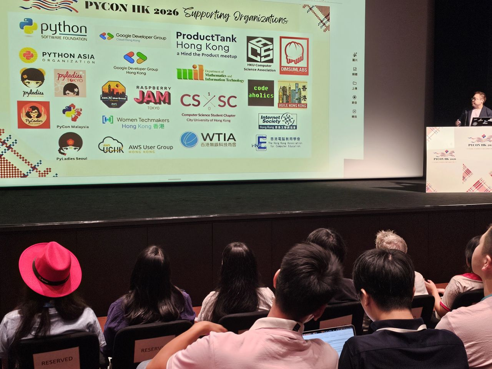
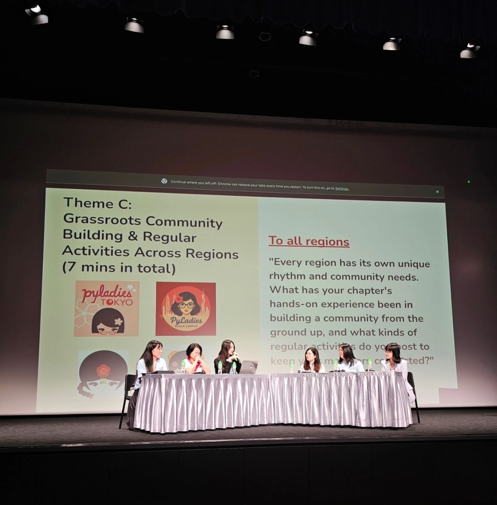
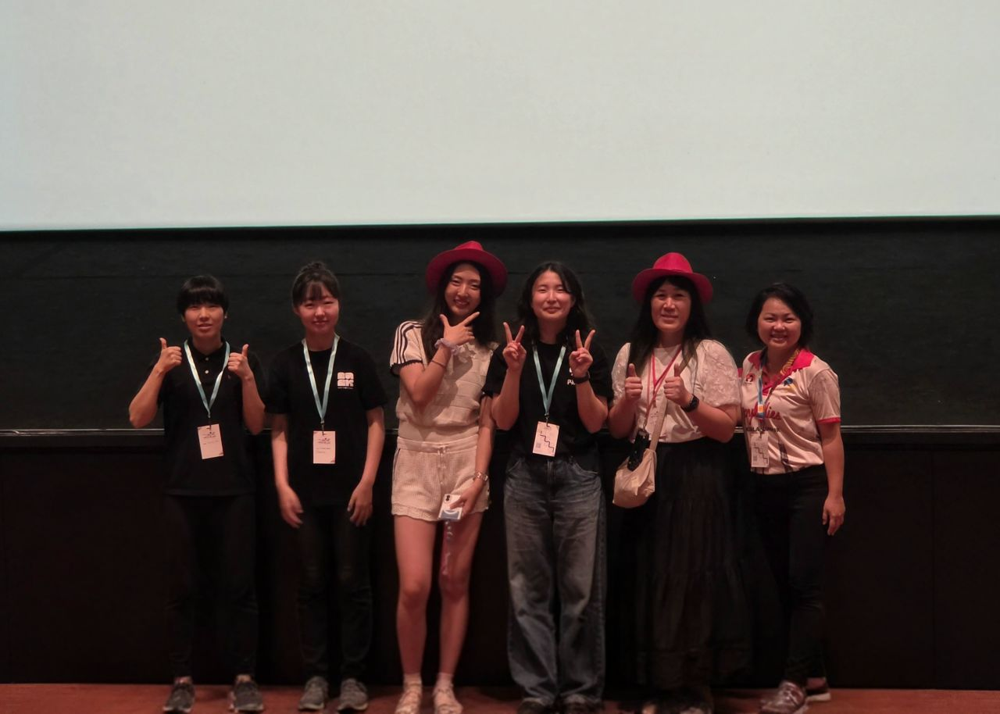
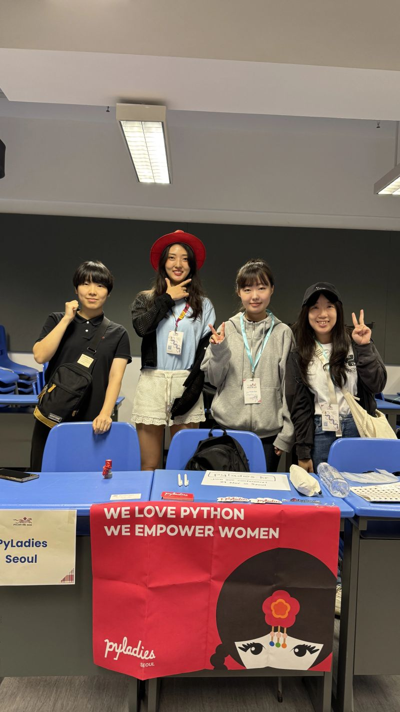
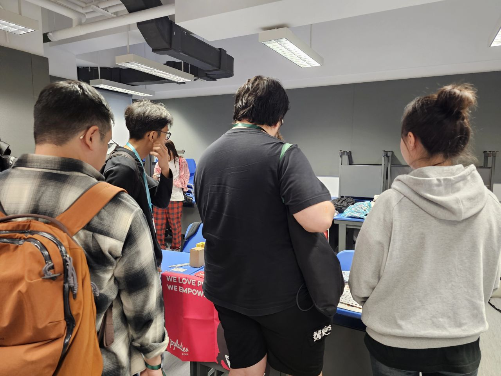
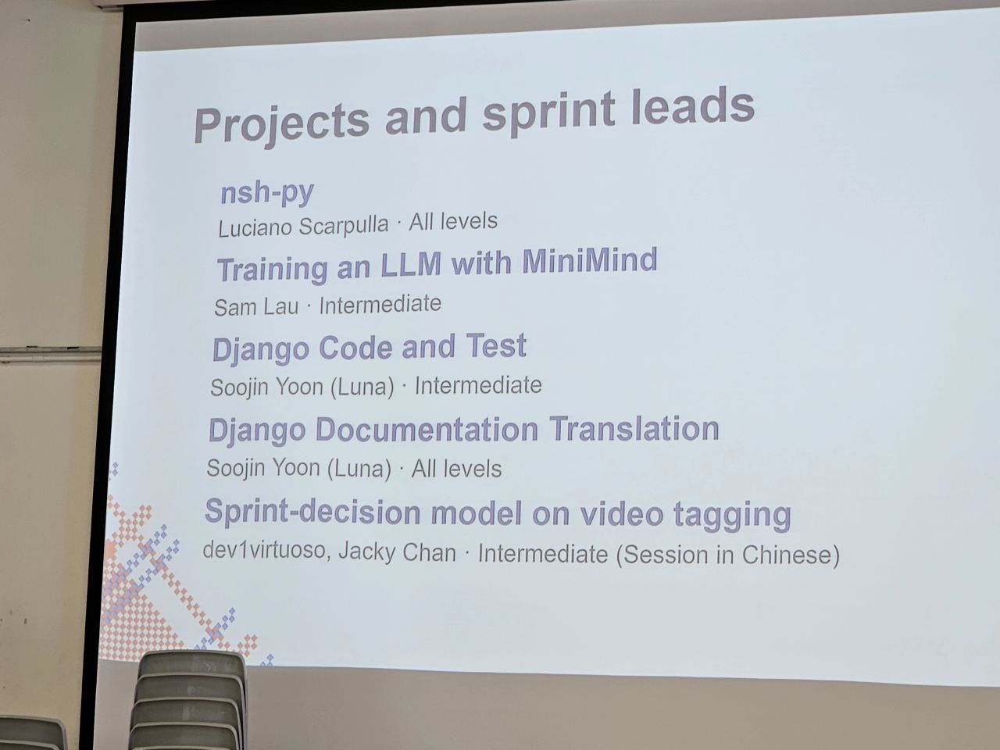
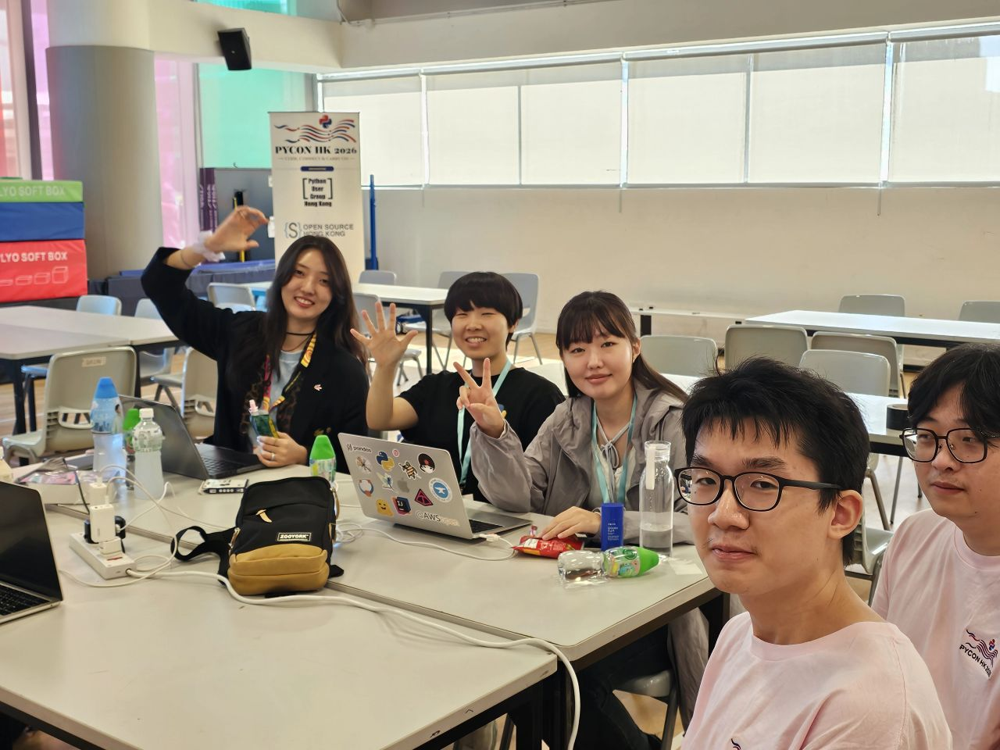

# PyCon Hong Kong 2026 🐍🇭🇰

Had an incredibly rewarding time at **PyCon Hong Kong 2026**!

**Soojin Yoon, Chanhee Baek, Sunyoung Park, and I** joined the **PyLadies Panel Talk** to share our journey of growing **PyLadies Seoul**. It was an insightful session discussing not just community growth, but also long-term sustainability alongside **PyLadies Hong Kong, PyLadies Tokyo, and PyLadies Kuala Lumpur**.

We also ran the **PyLadies Seoul** booth to promote the upcoming PyLadies Asia event on November 29th and led an Open Source Sprint to contribute to the community. Honestly, I got lost quite a few times during the visit—but those detours actually led to unexpected discoveries. I'm taking that as a great lesson and fuel for my future research.

A huge thank you to the **PyCon Hong Kong** organizers and all the volunteers for making this unforgettable experience possible.

It was a pleasure connecting with the Python community in Hong Kong. Looking forward to staying connected and meeting everyone again at future PyLadies events!

## Gallery

#PyConHongKong #PyConHK2026 #Python #PyLadies #PyLadiesSeoul
